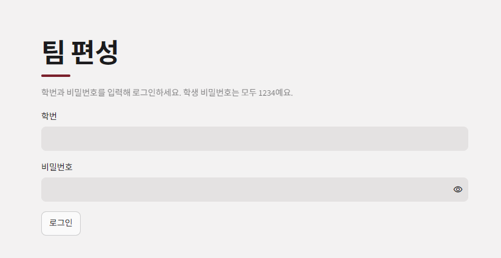

# 팀 편성 웹 앱

학생이 팀에 지원하고 투표하며, 관리자가 마감한 뒤 AI로 남은 학생을 배정하는 Streamlit 앱입니다. (작성자: 정지수)

## 1. 배포 주소

> (직접 채우기) 예: https://○○○.streamlit.app

## 2. PRD와 구현 계획의 위치

- PRD: `docs/PRD.md`
- 구현 계획: `docs/구현 계획.md`

## 3. 고른 해결 방법

| 기능 | 고른 해결 | 구현 |
|---|---|---|
| 다른 사람의 변경 보기 | 어려운 해결 | `st.fragment(run_every=3)`로 3초마다 바뀐 부분만 다시 그림 (`streamlit_app.py`의 `live_view`) |
| 필수 포함 역할을 지킬 수 없는 팀 | 어려운 해결 | 지원 단계에서, 기획자와 웹 프로그래머 자리를 채울 수 없게 되는 지원은 "막힘" (`rules.py`의 `check_apply`) |
| 같은 팀에 대기 중인 지원이 여럿 | 어려운 해결 | 승인 직전에 규칙을 다시 검사하고 어기면 거절 (`service.py`의 `vote`) |
| 마지막 자리에 두 명이 동시에 들어감 | 어려운 해결 | DB의 유일성 제약 `(team_id, slot_no)`와 팀 행 잠금 (`schema.sql`, `db.py`의 `insert_member`) |
| AI 응답이 늦을 때 | 어려운 해결 | 모델마다 응답 전체 120초를 재서 끊고 다음 모델로 넘어감 (`ai_client.py`의 `call_model`) |
| 3차 모델까지 실패 | 어려운 해결 | 검사 다섯 가지를 모두 통과하는 배정을 앱이 끝까지 찾음 (`assignment.py`의 `solve_assignment`) |
| AI 대기 중 화면 | 어려운 해결 | 몇 차 모델의 응답을 기다리는 중인지 `assign_status`에 보여 줌 |
| DB 일시정지 막기 | 어려운 해결 | GitHub Actions가 매일 DB에 질의를 보냄 (`.github/workflows/keepalive.yml`) |

## 4. 쓴 모델 3개

> (배포 전 `python scripts/check_models.py`로 확인한 뒤 실제로 쓴 이름으로 맞추기)

- 1차 `poolside/laguna-s-2.1:free`
- 2차 `nvidia/nemotron-3.5-lightning:free`
- 3차 `thinkingmachines/inkling:free`

모델은 환경변수 `AI_MODELS`(쉼표로 구분, 모두 `:free`)로 바꿀 수 있고, `openrouter/free`는 쓰지 않습니다.

## 5. 오픈라우터 AI 모델 호출 실패 사례

> (직접 채우기) 배포한 앱으로 연습 시나리오를 돌리며 실제로 본 실패만 적습니다. 지어내지 않습니다.
> 형식: 어떤 모델이 어떻게 실패했고 앱이 어떻게 처리했는지 + 화면 파일(예: `img/ai-timeout.png`).
> 관리자 화면의 AI 배정 상태 칸(`assign_status`)과 DB의 `tf_ai_logs` 표가 근거가 됩니다.

## 6. 클로드가 잘못 추론하거나 답한 사례

클로드가 로그인 화면에 "학생 비밀번호는 모두 1234예요"라는 안내 문구를 넣었다. 비밀번호가 화면에 나오면 안 된다는 점을 놓친 것이다. 배포한 앱의 로그인 화면을 직접 보다가 알아챘고, 커밋 `____`에서 그 문구를 지웠다. 지운 뒤에는 화면에 "1234"가 없는지 확인하는 테스트(`tests/test_ui_keys.py`의 `test_login_screen_hides_student_password`)를 추가했다.

- 알아챈 화면(문구가 보이는 로그인 화면): `img/password-hint.png`



> (직접 채우기) 위 `____`를 `git log --oneline`에서 찾은 "로그인 화면의 비밀번호 안내 삭제" 커밋 번호로 바꾸세요. 그 커밋 화면(GitHub의 Files changed)을 `img/`에 하나 더 넣으면 근거가 더 확실해집니다.

## 7. 제출한 앱에서 발견한 문제점과 개선할 점

> (직접 채우기) 연습 시나리오를 직접 돌려 본 단계와 화면을 근거로 적습니다. "문제 없음"은 인정되지 않습니다.

- 후보(직접 확인 후 사용): 마감 뒤 "규칙을 지키는 배정이 없음"이 나왔을 때, 이유 문장이 어느 팀의 어떤 역할이 모자란지까지 알려 주는지 확인해 보고, 부족하면 개선할 점으로 적기 (시나리오 `____` ____단계, 화면: `img/____.png`).

---

## 참고: 구성과 실행

| 파일 | 역할 |
|---|---|
| `streamlit_app.py` | 화면과 화면 key |
| `service.py` | 지원·투표·마감·배정·확정 |
| `rules.py`, `assignment.py` | 팀 규칙 검사, 직접 배정 풀이 |
| `ai_client.py` | OpenRouter 무료 모델 1·2·3차 호출 |
| `schema.sql`, `db.py` | `tf_` 표와 연결 풀 (앱 시작 시 자동 생성) |
| `scripts/` | 제출 전 점검, zip 만들기, 모델 이름 확인 |

설정값(`DATABASE_URL`, `OPENROUTER_API_KEY`, `ADMIN_PASSWORD`)은 코드에 적지 않고 Streamlit Secrets와 GitHub Secrets에만 넣습니다.

```
pip install -r requirements.txt
streamlit run streamlit_app.py
python scripts/audit.py          # 제출 전 점검
python scripts/make_zip.py 학번   # 제출용 zip
```
