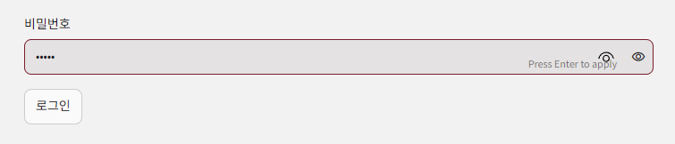

# 팀 편성 웹 앱

학생이 팀에 지원하고 투표하며, 관리자가 마감한 뒤 AI로 남은 학생을 배정하는 Streamlit 앱입니다. (작성자: 정지수)

## 1. 배포 주소

> (직접 채우기) 예: https://○○○.streamlit.app

## 2. PRD와 구현 계획의 위치

- PRD: `docs/PRD.md`
- 구현 계획: `docs/구현 계획.md`

## 3. 고른 해결 방법

| 기능 | 고른 해결 | 구현 |
|---|---|---|
| 다른 사람의 변경 보기 | 어려운 해결 | `st.fragment(run_every=3)`로 3초마다 바뀐 부분만 다시 그림 (`streamlit_app.py`의 `live_view`) |
| 필수 포함 역할을 지킬 수 없는 팀 | 어려운 해결 | 지원 단계에서, 기획자와 웹 프로그래머 자리를 채울 수 없게 되는 지원은 "막힘" (`rules.py`의 `check_apply`) |
| 같은 팀에 대기 중인 지원이 여럿 | 어려운 해결 | 승인 직전에 규칙을 다시 검사하고 어기면 거절 (`service.py`의 `vote`) |
| 마지막 자리에 두 명이 동시에 들어감 | 어려운 해결 | DB의 유일성 제약 `(team_id, slot_no)`와 팀 행 잠금 (`schema.sql`, `db.py`의 `insert_member`) |
| AI 응답이 늦을 때 | 어려운 해결 | 모델마다 응답 전체 120초를 재서 끊고 다음 모델로 넘어감 (`ai_client.py`의 `call_model`) |
| 3차 모델까지 실패 | 어려운 해결 | 검사 다섯 가지를 모두 통과하는 배정을 앱이 끝까지 찾음 (`assignment.py`의 `solve_assignment`) |
| AI 대기 중 화면 | 어려운 해결 | 몇 차 모델의 응답을 기다리는 중인지 `assign_status`에 보여 줌 |
| DB 일시정지 막기 | 어려운 해결 | GitHub Actions가 매일 DB에 질의를 보냄 (`.github/workflows/keepalive.yml`) |

## 4. 쓴 모델 3개

> (배포 전 `python scripts/check_models.py`로 확인한 뒤 실제로 쓴 이름으로 맞추기)

- 1차 `poolside/laguna-s-2.1:free`
- 2차 `nvidia/nemotron-3.5-lightning:free`
- 3차 `thinkingmachines/inkling:free`

모델은 환경변수 `AI_MODELS`(쉼표로 구분, 모두 `:free`)로 바꿀 수 있고, `openrouter/free`는 쓰지 않습니다.

## 5. 오픈라우터 AI 모델 호출 실패 사례

**관련 사례: AI를 부르기 전에 배정이 불가능하다고 판단한 경우 (모델 호출 실패는 아님)**

마감 뒤 관리자 화면에서 "AI 배정"을 눌렀더니 "규칙을 지키는 배정이 없음"이 나왔다. 앱이 AI를 부르기 전에 직접 풀이로 먼저 검사해서, 지금 상태로는 규칙(팀 인원, 주 역할 중복, 필수 포함 역할)을 모두 지키는 배정이 없다고 판단했기 때문이다. 이 경우 앱은 배정안을 만들지 않고 AI도 부르지 않는다(공고 2.5절 8항). 화면 아래의 "최근 AI 호출 기록"에 "아직 AI를 부른 기록이 없음"이 나오는 것이 AI를 부르지 않았다는 근거다. 그래서 이 사례는 모델이 실패한 것이 아니라 호출 전에 걸러진 것이다.


> (직접 채우기) 위 화면은 시나리오 `____`의 ____단계에서 나온 것입니다. 단계를 확인해 적으세요.

**모델 호출 실패 사례**

> (직접 채우기) 실제 모델이 시간 초과, 빈 응답, 오류, 틀린 배정을 낸 기록이 있으면, 관리자 화면의 "최근 AI 호출 기록" 표 화면(예: `img/ai-timeout.png`)과 함께 적습니다. 아직 실패가 한 번도 없었다면 "실제 실패 사례는 없었다"고 사실대로 적습니다. 지어내지 않습니다.

## 6. 클로드가 잘못 추론하거나 답한 사례

클로드가 로그인 화면에 "학생 비밀번호는 모두 1234예요"라는 안내 문구를 넣었다. 비밀번호가 화면에 나오면 안 된다는 점을 놓친 것이다. 배포한 앱의 로그인 화면을 직접 보다가 알아챘고, 커밋 `____`에서 그 문구를 지웠다. 지운 뒤에는 화면에 "1234"가 없는지 확인하는 테스트(`tests/test_ui_keys.py`의 `test_login_screen_hides_student_password`)를 추가했다.

- 알아챈 화면(문구가 보이는 로그인 화면): `img/password-hint.png`


> (직접 채우기) 위 `____`를 `git log --oneline`에서 찾은 "로그인 화면의 비밀번호 안내 삭제" 커밋 번호로 바꾸세요. 그 커밋 화면(GitHub의 Files changed)을 `img/`에 하나 더 넣으면 근거가 더 확실해집니다.

## 7. 제출한 앱에서 발견한 문제점과 개선할 점

**문제점: 로그인 화면에서 Enter 키를 눌러도 로그인되지 않음**

배포한 앱의 로그인 화면(모든 연습 시나리오의 첫 단계)에서 비밀번호 칸에 글자를 쓰면 칸 안에 "Press Enter to apply"라는 안내가 나온다. 그래서 Enter를 누르면 로그인될 것처럼 보이지만, 로그인 단추를 따로 눌러야만 로그인되었다. 입력칸이 폼으로 묶여 있지 않아서 Enter가 단추를 누르는 동작으로 이어지지 않은 것이다. 사용자가 이 화면을 보고 직접 알아챘다.



편의성 개선: 로그인 단추뿐 아니라 Enter 키로도 로그인되도록 했다. 로그인 입력칸을 `st.form`으로 묶고 로그인 단추를 `st.form_submit_button`으로 바꿔 Enter로도 로그인되게 했다(커밋: `____`). 화면 key는 그대로다. Enter로 로그인되는지 확인하는 테스트(`tests/test_ui_keys.py`의 `test_enter_key_logs_in`)를 추가했다.

> (직접 채우기) 위 `____`를 `git log --oneline`에서 "로그인 Enter 키" 커밋 번호로 바꾸세요.

**문제점 2: "규칙을 지키는 배정이 없음"의 이유가 같은 말을 반복하고 구체적이지 않음**

AI 배정이 불가능할 때 관리자 화면에 "규칙을 지키는 배정이 없음: 규칙을 지키는 배정이 없음(팀 인원과 역할 조건을 한꺼번에 만족하는 조합이 없음)"이 나왔다. 앞의 문구와 이유의 첫머리가 같은 말이라 중복되고, 이유도 어느 팀의 어떤 역할이 모자란지 알려 주지 않는다. 공고 2.5절 8항은 "팀3에 웹 프로그래머를 맡을 학생이 없음"처럼 구체적인 이유를 예로 든다.


개선: 이유 문장에서 반복되던 앞부분을 지웠다(커밋: `____`). 일반적인 이유 문장은 "남은 학생을 어떻게 나눠 넣어도 팀 인원, 주 역할 중복, 필수 포함 역할 중 하나를 어기게 됨"으로 바꿨다. 어느 팀의 어떤 역할이 모자란지 더 구체적으로 알려 주는 것은 아직 만들지 못한 개선점으로 남아 있다.

> (직접 채우기) 위 문제는 시나리오 `____`의 ____단계에서 발견했습니다. 위 `____`는 커밋 번호로 바꾸세요.

> (선택, 직접 확인한 것만 추가) 다른 문제점이 있으면 시나리오 단계와 화면을 근거로 이어서 적으세요.

---

## 참고: 구성과 실행

| 파일 | 역할 |
|---|---|
| `streamlit_app.py` | 화면과 화면 key |
| `service.py` | 지원·투표·마감·배정·확정 |
| `rules.py`, `assignment.py` | 팀 규칙 검사, 직접 배정 풀이 |
| `ai_client.py` | OpenRouter 무료 모델 1·2·3차 호출 |
| `schema.sql`, `db.py` | `tf_` 표와 연결 풀 (앱 시작 시 자동 생성) |
| `scripts/` | 제출 전 점검, zip 만들기, 모델 이름 확인 |

설정값(`DATABASE_URL`, `OPENROUTER_API_KEY`, `ADMIN_PASSWORD`)은 코드에 적지 않고 Streamlit Secrets와 GitHub Secrets에만 넣습니다.

```
pip install -r requirements.txt
streamlit run streamlit_app.py
python scripts/audit.py          # 제출 전 점검
python scripts/make_zip.py 학번   # 제출용 zip
```
